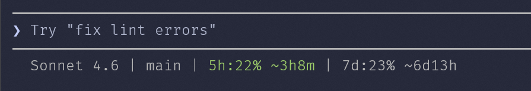

# claude-code-quota

Displays your Claude Code OAuth quota (5-hour session % and weekly %) live in
your terminal status line, with no daemon process required.

```
Sonnet 4.6 | main | ctx:42% | 5h:68% ~1h12m | 7d:31% ~4d2h
```

If your plan includes a model- or surface-scoped limit (a separate allowance
from the 5h and weekly buckets), it gets its own segment — and only appears
when you actually have one:

```
Opus 5 | main | ctx:42% | 5h:60% ~48m | 7d:59% ~1d2h | Fable:90%⚠
```



Works on **Windows 11** (PowerShell — no extra dependencies) and
**Linux / WSL2** (bash + `jq`).  

## Install as a Claude Code plugin

The repo is its own plugin marketplace. Inside Claude Code:

```
/plugin marketplace add aweussom/claude-code-quota
/plugin install claude-code-quota@aweussom
```

This gives you the `/quota` skill immediately. Claude Code plugins cannot
configure the status line itself (that lives in your own `settings.json`), so
after installing, ask Claude to *"set up my quota statusline"* — the skill
walks it through running the installer — or run `install.ps1` / `install.sh`
yourself as described below.

Based on the work in:
- https://github.com/jonis100/claude-quota-tracker
- https://github.com/ryoppippi/ccusage
- https://github.com/pcvelz/ccstatusline-usage#-quick-start
- ...and my own ugly hack https://github.com/aweussom/claude-quota-scraper

---

## How it works

On every status line refresh Claude Code emits, the library:

1. Checks the age of a local cache file (`~/.claude/quota-data.json`)
2. If fresh enough — returns immediately (no network call)
3. If stale — fires a background refresh (non-blocking), returns the previous
   frame's data immediately; the next frame gets fresh data
4. On the very first call (no cache) — blocks briefly for the initial fetch

The TTL is controlled by the caller:
- **60 seconds** while an active session is running (transcript recently written)
- **5 minutes** while idle

The caller's TTL is a floor, not the final word. After a failed fetch the library
tapers its own retries — 60s, 120s, 240s, 480s, capped at 15 minutes — keyed on
the `consecutive_failures` counter in the cache. Without this, a rate-limited or
briefly unreachable endpoint gets retried on every refresh, which turns a short
outage into a long one.

Several Claude Code sessions share one cache file, so both are concurrency-safe:
the cache is written to a temp file and renamed (readers see the old or new file,
never a half-written one), and the fetch lock is created with `O_EXCL` /
`FileMode::CreateNew` so simultaneous sessions can't all launch a fetch at once.
A lock is treated as abandoned once it exceeds 120 seconds, since PIDs get
recycled and a reused PID would otherwise look like a fetch in flight forever.

### When a fetch fails

Failures are never silent — the reason is written to the cache and exposed to
your statusline script:

- **Old data still available** → the percentage keeps showing with a `⚠`
  appended (stale marker). Run `/quota` to see the full error.
- **Old data available but its window has since reset** → the percentage is
  dropped and the segment shows `?⚠`. The stored figure describes a window that
  has already been spent, so it is no longer reported as fact. See
  [Unknown vs. missing](#unknown-vs-missing--show--not-a-stale-number).
- **No data at all** (first fetch failed, e.g. missing OAuth token) → the
  `error` result field carries a human-readable reason, and the bundled
  statusline shows it in red, e.g. `quota: Cannot read OAuth token.`
- **Unreadable cache file** → `error` says so and suggests deleting
  `~/.claude/quota-data.json` to reset.

---

## Windows 11 / PowerShell

No WSL required. Uses `Invoke-RestMethod` and `ConvertFrom-Json` — no `jq`,
`curl`, or other external tools needed.

> **Why PowerShell, not bash?**
> Claude Code runs `settings.json` commands via bash on Windows (Git Bash),
> but bash scripts require `jq` for JSON parsing which is not bundled with
> Git for Windows. PowerShell's built-in cmdlets cover everything with zero
> extra installs.

### Quick install

```powershell
pwsh -ExecutionPolicy Bypass -File .\install.ps1
```

The installer:

1. Requires `pwsh` (PowerShell 7+) and aborts if it is missing or not on PATH
2. Checks for the Claude OAuth credentials file
3. Copies `quota-lib.ps1` and `_quota-fetch-helper.ps1` to `%USERPROFILE%\.claude\`
4. Optionally copies `skills\quota\SKILL.md` (enables the `/quota` skill)
5. If no statusline exists — installs `statusline.ps1.template` as
   `%USERPROFILE%\.claude\statusline.ps1` and offers to write `settings.json`
6. If an existing statusline is detected — leaves everything unchanged and
   prints an integration snippet showing how to add quota to your script

### Manual integration

#### 1. Copy the library files

```powershell
Copy-Item quota-lib.ps1           "$env:USERPROFILE\.claude\quota-lib.ps1"
Copy-Item _quota-fetch-helper.ps1 "$env:USERPROFILE\.claude\_quota-fetch-helper.ps1"
```

#### 2. Add to your statusline script

Near the top of `%USERPROFILE%\.claude\statusline.ps1`, dot-source the library
and call `Invoke-QuotaGet`:

```powershell
$libPath = "$env:USERPROFILE\.claude\quota-lib.ps1"
if (Test-Path $libPath) {
    . $libPath

    $ttl = 300
    if ($session.transcript_path -and (Test-Path $session.transcript_path)) {
        $tAge = ([DateTimeOffset]::UtcNow -
                 (Get-Item $session.transcript_path).LastWriteTimeUtc).TotalSeconds
        if ($tAge -lt 300) { $ttl = 60 }
    }

    Invoke-QuotaGet -Ttl $ttl
}
```

> **Note:** if your statusline outputs non-ASCII glyphs (like the `⚠` stale
> marker below), set the output encoding near the top of your script —
> otherwise PowerShell writes captured stdout in the OEM code page and the
> glyphs come out as `?`:
>
> ```powershell
> [Console]::OutputEncoding = [System.Text.Encoding]::UTF8
> ```

Then display the values:

```powershell
$qpct     = $QuotaResult['pct']       # "68"
$resetsIn = $QuotaResult['resets_in'] # "1 hr 12 min"
$isStale  = $QuotaResult['stale'] -eq 'true'
$qerr     = $QuotaResult['error']     # why the last fetch failed, or ""

if ($qpct -ne "") {
    $display = "${qpct}%"
    if ($isStale)  { $display += "⚠" }   # last fetch failed; this is older data
    if ($resetsIn) { $display += " ↻$resetsIn" }
    Write-Output "5h:$display"
} elseif ($qerr -ne "") {
    # No quota data at all — say why instead of silently showing nothing
    Write-Output "quota: $qerr"
}
```

#### 3. Enable the `/quota` skill (optional)

```powershell
New-Item -ItemType Directory -Force "$env:USERPROFILE\.claude\skills\quota" | Out-Null
Copy-Item skills\quota\SKILL.md "$env:USERPROFILE\.claude\skills\quota\SKILL.md"
```

Type `/quota` inside Claude Code for an on-demand quota summary. You can also
ask Claude "how do I add quota to my statusline?" and it will walk you through
the integration using the context from this skill.

#### 4. Point Claude Code at your statusline script

In `%USERPROFILE%\.claude\settings.json`:

```json
{
  "statusLine": {
    "type": "command",
    "command": "pwsh -NoProfile -NonInteractive -ExecutionPolicy Bypass -File C:/Users/<you>/.claude/statusline.ps1"
  }
}
```

> **Important:** use an absolute path with forward slashes. Claude Code
> executes this command via bash on Windows, where `%USERPROFILE%` is **not**
> expanded. The installer writes the correct absolute path automatically.

The command must invoke `pwsh`. Windows PowerShell 5.1 (`powershell.exe`) is
not supported: it reads these UTF-8 scripts as ANSI, mangling the glyphs, and
the statusline refuses to run under it.

### `$QuotaResult` reference

| Key | Value |
|-----|-------|
| `pct` | 5-hour session usage %, or `""` |
| `weekly_pct` | 7-day usage %, or `""` |
| `resets_in` | Time until 5h reset, e.g. `"1 hr 12 min"`, or `""` |
| `weekly_resets_in` | Time until weekly reset, or `""` |
| `stale` | `"true"` if the last fetch failed, `"false"` otherwise |
| `valid` | `"true"` if the last fetch succeeded |
| `error` | Human-readable reason for the last failure, or `""` |
| `pct_unknown` | `"true"` when the 5h window rolled over while fetches were failing — see below |
| `weekly_pct_unknown` | Same, for the weekly window |
| `scoped_summary` | All scoped limits, e.g. `"Fable:90%"`, or `""` |
| `scoped_alert` | `"true"` if any scoped limit has severity above normal |
| `scoped_worst` | Label of the highest scoped limit, or `""` |
| `scoped_worst_pct` | Its percentage, or `""` |
| `scoped_worst_resets_in` | Its countdown — **only** when it differs from the weekly reset, so you don't print the same time twice |

Scoped limits are read generically from the API's `limits[]` array, keyed on
`scope.model.display_name`. No model name is hardcoded: if the scoped bucket on
your plan changes, the label changes with it and no code needs touching. All
five keys are `""` / `"false"` for accounts with no scoped limits.

#### Unknown vs. missing — show `?`, not a stale number

A cached percentage is trustworthy only until the window it describes resets.
If fetches are failing when a window rolls over, the library can *prove* the
figure it holds is obsolete: the usage reset and it never saw the new value. In
that case it drops the percentage and sets `pct_unknown` (or
`weekly_pct_unknown`) instead of carrying the old one forward.

Render that as `?`, not as an omitted segment — a missing segment reads as "no
limit", whereas `?` says "we don't know":

```powershell
if ($qpct -ne "") {
    # ... normal render
} elseif ($QuotaResult['pct_unknown'] -eq 'true') {
    Write-Output "5h:?⚠"
}
```

Buckets are evaluated independently, so a rolled-over 5h window doesn't disturb
the weekly or scoped figures. Expired scoped buckets are dropped from
`scoped_limits` under the same rule.

### Execution policy

Windows blocks unsigned scripts by default. There are two ways past that, and
they are both listed deliberately — they cover different environments:

```powershell
# Standalone / unmanaged Windows: nothing to do. The -ExecutionPolicy Bypass
# flag already in the settings.json command is sufficient.

# Managed / corporate machine (Entra-joined, GPO/Intune): if Bypass doesn't
# take effect, set a persistent per-user policy instead (no admin needed):
Set-ExecutionPolicy -ExecutionPolicy RemoteSigned -Scope CurrentUser
```

Why two paths? `-ExecutionPolicy Bypass` only sets the **Process**-scope
policy, which sits *below* `MachinePolicy` and `UserPolicy` in PowerShell's
precedence order. On a machine where group policy or MDM sets an execution
policy, Bypass is silently overridden, while a `CurrentUser` policy written to
the registry may still be honored. On an unmanaged machine no such override
exists and Bypass alone is enough. (This managed-machine explanation is
inferred from observed behavior on one Entra-joined machine, not confirmed
against an actual GPO/Intune configuration — see below for how to check yours.)

To see which case applies to your machine:

```powershell
Get-ExecutionPolicy -List
```

- If `MachinePolicy` or `UserPolicy` shows anything other than `Undefined`,
  group policy/Intune is in charge: Bypass will be ignored and the
  `Set-ExecutionPolicy` route is your only option (and may itself be blocked,
  depending on how strict the policy is).
- If both are `Undefined`, Bypass wins over every other scope and the
  `settings.json` command works as-is — no policy change needed.
- If both are `Undefined` but scripts *still* refuse to run, check
  `$ExecutionContext.SessionState.LanguageMode`: `ConstrainedLanguage` means
  AppLocker/WDAC is restricting PowerShell, which no execution-policy setting
  can fix.

### Performance

- `pwsh` (PowerShell 7+): ~100–200 ms cold start — required

Windows PowerShell 5.1 is not supported. `install.ps1` and `statusline.ps1`
both carry `#Requires -Version 7.0` and stop immediately under it.

The background refresh adds no extra latency: it runs as a detached process
while the statusline immediately returns the previous frame's cached data.

---

## Linux / WSL2

### Requirements

- Claude Code with OAuth login (`claude login`)
- `jq` and `curl` — `sudo apt install jq curl`
- Bash 4.2+

### Quick install

```bash
bash install.sh
```

The installer:

1. Checks for `jq` and `curl`
2. Copies `quota-lib.sh` to `~/.claude/`
3. Optionally copies `skills/quota/SKILL.md` (enables the `/quota` skill)
4. Prints a snippet to add to your existing statusline script

### Manual integration

#### 1. Copy the library

```bash
cp quota-lib.sh ~/.claude/quota-lib.sh
```

#### 2. Add to your statusline script

Near the top of `~/.claude/statusline.sh` (before you build the display),
source the library and call `quota_get`:

```bash
_QL_LIB="${HOME}/.claude/quota-lib.sh"
if [[ -f "$_QL_LIB" ]]; then
    source "$_QL_LIB"

    _quota_ttl=300
    _transcript_path=$(echo "$input" | jq -r '.transcript_path // empty')
    if [[ -n "$_transcript_path" && -f "$_transcript_path" ]]; then
        _t_age=$(( $(date +%s) - $(stat -c %Y "$_transcript_path" 2>/dev/null || echo 0) ))
        (( _t_age < 300 )) && _quota_ttl=60
    fi

    quota_get "$_quota_ttl"
fi
```

Then display the values:

```bash
_qpct="${QUOTA_RESULT[pct]:-}"
if [[ -n "$_qpct" && "$_qpct" != "null" ]]; then
    if awk "BEGIN{exit !($_qpct + 0 > 75)}" 2>/dev/null; then
        _qcolor='\033[31m'
    elif awk "BEGIN{exit !($_qpct + 0 > 50)}" 2>/dev/null; then
        _qcolor='\033[33m'
    else
        _qcolor='\033[32m'
    fi

    _qstale="${QUOTA_RESULT[stale]:-false}"
    _qresets="${QUOTA_RESULT[resets_in]:-}"
    _qdisplay="${_qpct}%"
    [[ "$_qstale" == "true" ]] && _qdisplay="${_qdisplay}⚠"   # last fetch failed; older data
    [[ -n "$_qresets" && "$_qresets" != "null" ]] && _qdisplay="${_qdisplay} ↻${_qresets}"

    echo -e "${_qcolor}5h:${_qdisplay}\033[0m"
elif [[ -n "${QUOTA_RESULT[error]:-}" ]]; then
    # No quota data at all — say why instead of silently showing nothing
    echo -e "\033[31mquota: ${QUOTA_RESULT[error]}\033[0m"
fi
```

#### 3. Enable the `/quota` skill (optional)

```bash
mkdir -p ~/.claude/skills/quota
cp skills/quota/SKILL.md ~/.claude/skills/quota/SKILL.md
```

#### 4. Point Claude Code at your statusline script

In `~/.claude/settings.json`:

```json
{
  "statusLine": {
    "type": "command",
    "command": "~/.claude/statusline.sh"
  }
}
```

### `QUOTA_RESULT` array reference

| Key | Value |
|-----|-------|
| `pct` | 5-hour session usage %, or `""` |
| `weekly_pct` | 7-day usage %, or `""` |
| `resets_in` | Time until 5h reset, e.g. `"1 hr 12 min"`, or `""` |
| `weekly_resets_in` | Time until weekly reset, or `""` |
| `stale` | `"true"` if last fetch failed, `"false"` otherwise |
| `valid` | `"true"` if last fetch succeeded |
| `error` | Human-readable reason for the last failure, or `""` |
| `scoped_summary` | All scoped limits, e.g. `"Fable:90%"`, or `""` |
| `scoped_alert` | `"true"` if any scoped limit has severity above normal |
| `scoped_worst` | Label of the highest scoped limit, or `""` |
| `scoped_worst_pct` | Its percentage, or `""` |
| `scoped_worst_resets_in` | Its countdown — **only** when it differs from the weekly reset |
| `pct_unknown` | `"true"` when the 5h window rolled over while fetches were failing |
| `weekly_pct_unknown` | Same, for the weekly window |

See the `$QuotaResult` notes above for how scoped limits are derived and why
`pct_unknown` should render as `?`.

---

## Cache file format

`~/.claude/quota-data.json` (same path on Windows) — schema version 3:

```json
{
  "schema_version": 3,
  "lib_version": "1.2.0",
  "current_session": { "percent_used": 68, "resets_at": "...", "resets_in": "1 hr 12 min", "percent_unknown": false },
  "weekly_limits":   { "percent_used": 31, "resets_at": "...", "resets_in": "4 d 2 hr 5 min", "percent_unknown": false },
  "scoped_limits":   [
    { "label": "Fable", "kind": "weekly_scoped", "percent_used": 90,
      "severity": "critical", "resets_at": "...", "resets_in": "1d2h", "is_active": true }
  ],
  "extra_usage":     { "is_enabled": null, "utilization": null, "used_credits": null, "monthly_limit": null },
  "quota_used_pct":  68,
  "weekly_used_pct": 31,
  "resets_in":       "1 hr 12 min",
  "weekly_resets":   "4 d 2 hr 5 min",
  "valid": true,
  "stale": false,
  "error": "",
  "consecutive_failures": 0
}
```

On a failed fetch, `valid` flips to `false`, `stale` to `true`, and `error` /
`stale_reason` record why (e.g. `"OAuth token rejected (HTTP 401).
Re-authenticate Claude Code."`) — the previous data is retained so the
statusline can keep showing the last known values with a stale marker.

The exception is a bucket whose window has since reset: `percent_unknown` marks
it, and the stored percentage is dropped rather than shown, because the library
can prove it describes a spent window. Scoped buckets are removed from
`scoped_limits` under the same rule.

Both libraries write and read the same format, so a cache written by one is
readable by the other — useful if you move between environments, or install on
Windows now and Linux later.

They do **not** share a cache file, though. `~` resolves to a different place in
each: native Windows uses `%USERPROFILE%\.claude\`, while WSL2 uses the Linux
home (`/home/<you>/.claude/`). Install in both and you get two independent
caches.

That is the intended arrangement, and there's no need to change it. A second
cache costs one extra fetch per TTL — a handful of requests an hour, nowhere near
any rate limit — and in exchange each environment stays self-contained. Pointing
both at one file (by overriding `_QL_CACHE` / `$script:_QL_Cache`) is possible
but buys almost nothing and adds two failure modes: the WSL2 side would stat and
parse the file across `/mnt/c` on every refresh, and if the two sides are ever on
different library versions, an older one's writes omit `scoped_limits` — which
counts as a legitimate delete, so the scoped segment would appear and disappear
depending on which side wrote last.

---

## Tests

`tests/test-quota-lib.sh` covers the bash library: scoped-limit extraction and
label fallbacks, rollover invalidation, retry tapering, lock mutual exclusion and
stale-lock recovery, and atomic cache writes under concurrent writers. It uses
synthetic fixtures shaped like real API responses — no network calls, so it can't
consume quota or trip rate limits.

```bash
bash tests/test-quota-lib.sh        # requires jq
```

Exits `0` on success, `1` on failure, `2` if `jq` is missing.

## Proof of concept: Chrome/Edge scraper

`claude_quota_chrome.ps1` is an alternative fetcher that reads quota data
directly from the `claude.ai/settings/usage` page using Claude Code's built-in
`--chrome` flag (requires the **Claude in Chrome** extension and an active
login session in Edge or Chrome).

It is a proof of concept — not needed for normal use — but it does extract
quota figures correctly without touching the OAuth API.

```powershell
.\claude_quota_chrome.ps1
```

Pass `-Raw` to see the unprocessed Claude CLI output, or `-OutputFile path.json`
to write the result to a file.

---

## Notes

- The OAuth beta header (`oauth-2025-04-20`) may need updating if Anthropic
  releases a new API version. Update `_QL_Beta` in `quota-lib.ps1` or
  `_QL_BETA` in `quota-lib.sh`.
- On Linux/WSL2, credentials are read from `~/.claude/.credentials.json`.
  If Claude Code stores them in your Windows home, edit `_QL_CREDS` at the
  top of `quota-lib.sh` to point at the correct path.
